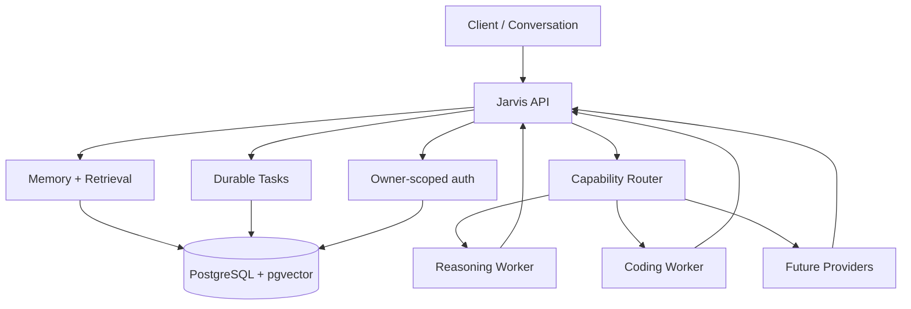

# Jarvis

**A persistent, model-independent personal AI control plane.**

Jarvis is an independent systems project focused on a problem that ordinary chat interfaces do not solve well: giving an AI assistant durable identity, memory, state, task execution, scheduling, permissions, and auditability that belong to the user rather than to any one model provider.

> Frontier models are workers. Jarvis owns the state.

The production source repository is private. This repository is a technical showcase of the architecture, design decisions, and engineering work behind the system.

## Why I built it

Most AI assistants are session-centric. Their useful state is fragmented across conversations, providers, and devices, and long-running work is difficult to make durable or auditable.

Jarvis is designed as a **persistent personal-AI control plane**: a system that can remember, retrieve, schedule, route, and resume work independently of whichever model happens to perform the reasoning or coding step.

## Architecture

## Core engineering ideas

### Durable memory with provenance
Jarvis separates raw conversation history from derived memory. Memories are grounded in immutable evidence, carry confidence and provenance, and can be superseded without rewriting history.

The memory layer includes:

- append-only evidence history
- structured durable memories
- entity resolution and canonical identities
- typed relationships between entities
- semantic retrieval with pgvector
- current-state projection so historical truth is not confused with present truth

### Provider-independent execution
AI providers sit behind a routing boundary rather than owning application state. The execution layer can select a compatible worker based on capability, availability, and durable cost policy while keeping checkpoints and task state provider-independent.

### Durable tasks
Long-running work is modeled as database state, not as a request that has to stay alive.

Tasks support:

- persistent lifecycle state
- idempotent execution claims
- immutable results
- crash-safe leases
- checkpoints for multi-step work
- explicit waits for user/external input
- time-based waking
- routing decisions recorded before execution

### Reliability and auditability
The architecture is intentionally conservative around state mutation. Important records are append-only or immutable, ownership is enforced at the data boundary, and execution decisions are persisted so the system can explain what happened after a restart or failure.

## Current stack

`Python` · `FastAPI` · `PostgreSQL` · `pgvector` · `SQLAlchemy` · `Alembic` · `Docker` · `Railway`

## Engineering scope

Jarvis has grown through a milestone-based architecture roadmap rather than as a single prompt-driven prototype. The system includes thousands of automated tests spanning persistence, routing, memory, task lifecycle, concurrency, idempotency, authentication, and failure behavior.

Representative areas of work:

- backend architecture and API design
- relational schema design and migrations
- concurrent task execution and leases
- semantic retrieval
- model/provider abstraction
- provenance and audit systems
- deterministic routing policy
- cloud deployment and restart survival

## Design principles

1. **The user owns durable state.** Model providers are replaceable.
2. **History is not silently rewritten.** Changed reality becomes new evidence.
3. **Tasks survive processes.** Durable work should not depend on one HTTP request or one container.
4. **Routing is explicit.** Capability, cost policy, and availability are recorded decisions.
5. **Failures should be inspectable.** Reliability comes from durable state and deterministic boundaries, not optimistic retries hidden from the user.

## Source availability

The production repository is private because Jarvis contains personal-assistant infrastructure, authentication logic, deployment assumptions, and ongoing experimental architecture.

This showcase intentionally contains **no credentials, private user data, production configuration, or proprietary source code**.

## Status

Active development. Current work is expanding the system from durable AI infrastructure toward increasingly autonomous personal workflows and multi-device use.
