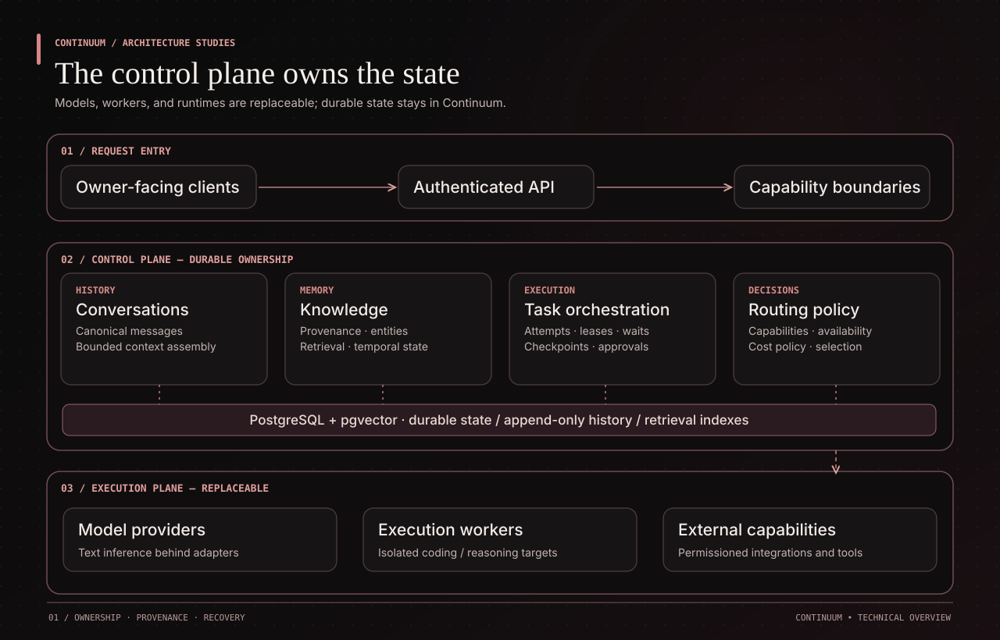
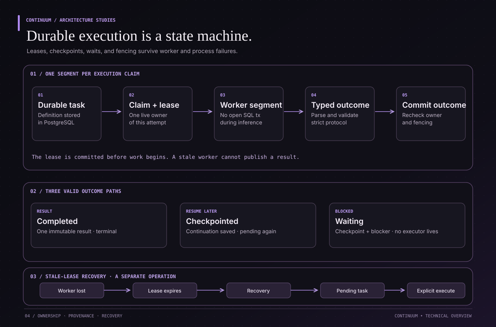
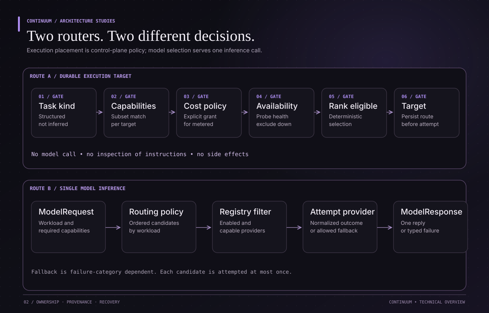
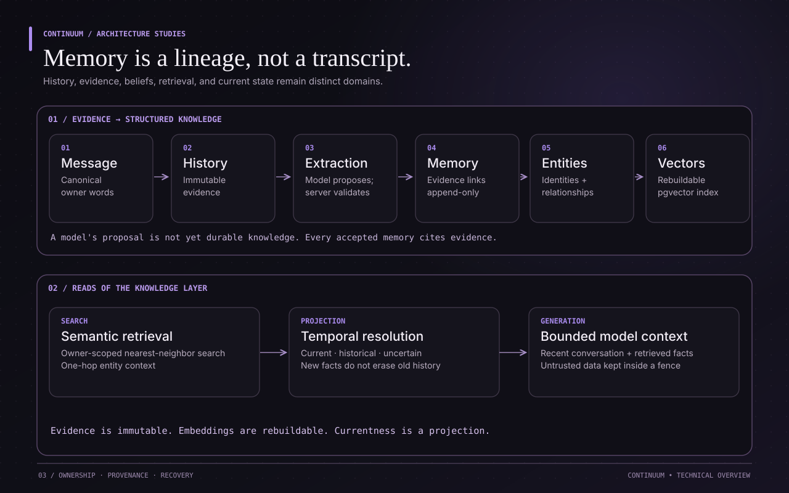
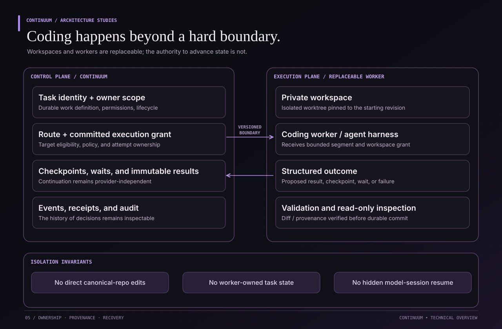

# Continuum

**Persistent, model-independent AI infrastructure.**

> Models and workers are replaceable. Neither owns Continuum state.

Continuum is a personal AI control plane built to make conversations, knowledge, long-running work, and execution decisions survive model changes, process restarts, and failed workers. It is deliberately **not** a thin chat wrapper: persistence, routing, provenance, and recovery live outside the model.

This is a public **architecture and engineering showcase**. The implementation repository is private; the diagrams document subsystem boundaries and important invariants without exposing the source or deployment secrets.

**Current focus:** durable personal AI infrastructure, reliability, and progressively richer agentic workflows. Some integrations and execution capabilities remain under development; architectural direction should not be mistaken for a claim of full production readiness.

## Architecture at a glance

The system has two fundamentally different responsibilities:

| Continuum control plane | Replaceable execution plane |
| --- | --- |
| Owns identities, tasks, memory, state transitions, routing policy, approvals, and audit records. | Runs inference, coding, or other bounded work through provider adapters and execution targets. |
| Persists decisions before handing out work and validates outcomes afterward. | Receives a request or task segment; never becomes the source of truth for the task. |
| Reconstructs context and recovery state from PostgreSQL. | Can be restarted or replaced without resurrecting a provider-private session. |

The goal is straightforward: a useful assistant should not forget its work because a container restarted or an AI provider changed. Making that reliable requires distinct subsystems, not one giant autonomous-agent loop.

## Durable execution, checkpointing, and continuation

A task is **durable work**, not an HTTP request or a model conversation. Its definition, attempts, ownership, continuation state, and terminal result are persisted independently of the process executing it.

### One execution attempt

1. **Commit the claim.** A task attempt acquires an execution lease before a provider or worker call. Concurrent contenders cannot all become the legitimate owner.
2. **Run one bounded segment.** No database transaction remains open during model inference. The target receives the segment and the committed continuation state it is authorized to use.
3. **Validate the outcome.** The result protocol is strict. Completion rechecks ownership and fencing rather than trusting a late response from a stale worker.
4. **Commit the transition.** A successful task receives one immutable result. A checkpoint preserves work done and what remains. A wait preserves that continuation plus an explicit blocker.
5. **Resume from durable state.** A later attempt can reconstruct its input from the committed checkpoint and any resolved wait, rather than a Claude, Codex, or other provider's private session.

A worker failure is not a reason to erase progress. When a lease expires, recovery handles the stale attempt while preserving the last valid checkpoint. A due-time wait may be resolved by a narrowly scoped scheduler, but **resolving a wait is not itself a model invocation**.

<strong>Implementation details — execution invariants</strong>

- Task definitions and terminal results are protected by immutability constraints; append-only events record lifecycle transitions without copying task instructions into the event stream.
- Claims and completions are separate transactions, with ownership revalidation before publishing an outcome.
- A checkpoint is owner-readable continuation work product, **not hidden chain-of-thought or a serialized model session**.
- Checkpointed work may return to a runnable state; waiting work cannot advance until its blocker is resolved.
- Wait resolution, lease recovery, and task execution are separate operations with different authority.
- Retry paths must not publish a second terminal result for an already completed task.

<!-- Optional short synthetic recovery GIF goes here after its binary asset is uploaded. -->

## Two routing layers, not one

The architecture separates **where a durable task segment executes** from **which model handles one inference call**.

### ExecutionRouter — select an execution target

The execution router receives structured requirements, **not the task's instructions**. It filters registered targets by capability, cost permission, and availability, then applies deterministic ranking. Its job is to select and record a permitted execution surface—not to ask an LLM what should run next.

A target being available does not authorize metered execution. Cost permission is an explicit policy decision, not an accidental consequence of having credentials.

### ModelRouter — handle one model request

The model router operates a level lower. It receives a bounded request, consults workload-specific policy and the provider registry, then attempts eligible provider adapters. Failures are normalized; fallback occurs only for permitted failure categories. Each eligible candidate is attempted at most once per route.

**Why both exist:** a coding harness and a text model are not interchangeable. A worker owns its runtime and tools; a model provider supplies an inference response. Neither should silently own task lifecycle.

<strong>Implementation details — routing guarantees</strong>

- Execution routing does not inspect prose or derive requirements from prompt wording.
- Execution selection is not dispatch: it does not itself run a model, claim work, or mutate task state.
- Capabilities, cost permissions, and health are distinct eligibility checks; permission to use metered execution is not preference for it.
- Model routing is request-scoped: it does not own scheduling, checkpoints, waits, or task continuation.
- A cancelled model call is not silently retried on another provider by the router.

## Memory, evidence, and temporal knowledge

Continuum distinguishes **what was said**, **what the system derived**, **what entities the statements refer to**, and **what remains true now**.

A conversation message becomes a canonical history event. Extraction may propose a belief, but it must be validated and linked back to evidence before becoming durable memory. Entities and relationships provide structured identity. Vector embeddings support retrieval, while a separate temporal projection resolves current, historical, and uncertain knowledge.

This matters when facts change. A statement that was correct last month should not disappear from history merely because newer evidence describes a different present.

### Example: knowledge changes, evidence doesn't

An owner once worked at Company A and now works at Company B. The first fact can remain historically true even when it no longer describes the present. Continuum retains the underlying evidence and derives **currentness as a projection**, rather than destructively rewriting the earlier record.

<strong>Implementation details — knowledge invariants</strong>

- Evidence and memories are separate persisted records. Each accepted memory needs provenance; derived beliefs are not new source evidence for themselves.
- Knowledge evolves through append-only records and supersession relationships rather than rewriting original claims.
- Entity references and typed relationships separate stable identities from propositions about them.
- Embeddings in PostgreSQL / pgvector are **rebuildable search artifacts**, not historical evidence; retrieval is owner-scoped.
- Context assembly preserves bounded conversation continuity while presenting retrieved text as untrusted data, not higher-priority instructions.
- Temporal state can represent current, historical, future, or unresolved knowledge. Recency of recording is not proof of factual replacement.

## Coding workers and workspace isolation

Coding work needs a different trust model from ordinary text generation. Continuum keeps task and authorization records in the control plane and hands the worker only the execution surface it was granted.

Workspaces start from an exact repository revision and use isolated worktrees. A worker operates on the private workspace—not directly on the canonical repository. Execution targets return structured outcomes and provenance for validation before Continuum advances durable state.

The boundary is intentionally asymmetric: **workers propose work product; Continuum decides what becomes committed state**.

<strong>Implementation details — isolation boundaries</strong>

- Workspace resolution and Git operations are separated from task persistence, and the control plane does not depend on host filesystem paths.
- Canonical repositories and per-attempt private workspaces have different roles; the worker may not edit the canonical repository directly.
- Worker adapters implement the execution-target contract; text-model adapters implement a separate inference-provider contract.
- Continuation inputs are explicit and bounded: task instructions, a relevant checkpoint, and optionally a resolved wait, not a hidden provider-session resume token.
- The control plane retains provenance for claims, routing decisions, attempts, outcomes, and artifacts.

## Other subsystems

The architecture also includes domains that do not fit in the five main diagrams:

| Domain | Engineering concern |
| --- | --- |
| **Conversation and context assembly** | Durable messages; reconstructing bounded model requests without model-owned sessions |
| **Scheduling** | Due-time resolution using database time; the scheduler cannot itself invoke a model |
| **Approval authority** | Digest-bound authorization for an exact action; approval is distinct from performing a side effect |
| **Artifacts** | Owner-scoped immutable records over content-addressed bytes, validation, and provenance |
| **History and auditing** | Owner-scoped evidence, lifecycle journals, and integrity checks |
| **Connectors and browser capabilities** | Delegated execution, isolation, and permission boundaries; integration coverage continues to evolve |

Not every architectural domain represents a finished autonomous end-user feature.

## Engineering and verification

Continuum has evolved through explicit architecture contracts and tests for failure behavior, not only successful model responses. The private codebase contains tests and audits around:

- Concurrent claims, idempotency, lease expiry, fencing, and recovery.
- Memory provenance, evidence ownership, retrieval boundaries, and temporal projection.
- Provider compatibility, execution routing, cost policy, and normalized failures.
- PostgreSQL constraints, migrations, append-only history, and owner scoping.
- Worker protocol validation, isolated workspaces, and execution provenance.

These diagrams describe the codebase's architectural boundaries. They are **not** a security certification or a claim that every experimental integration is production-ready.

### Core stack

**Python · FastAPI · PostgreSQL · pgvector · SQLAlchemy · Alembic · Docker · Railway**

## Source availability

The implementation is private. This repository is its public technical showcase, explaining architectural boundaries, engineering decisions, and failure-handling contracts without revealing proprietary code, credentials, live infrastructure details, or personal user data.

**Status:** active development toward a persistent assistant that owns its state, accounts for its decisions, and can continue work across models and processes.
